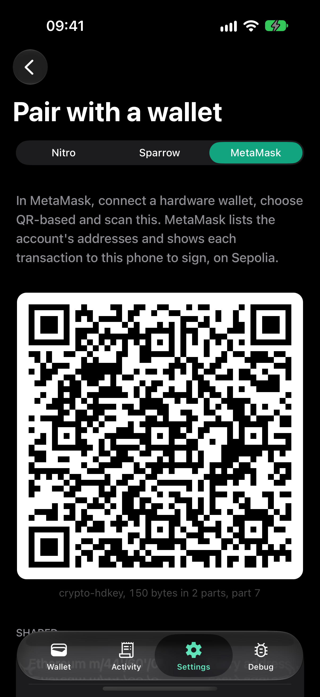
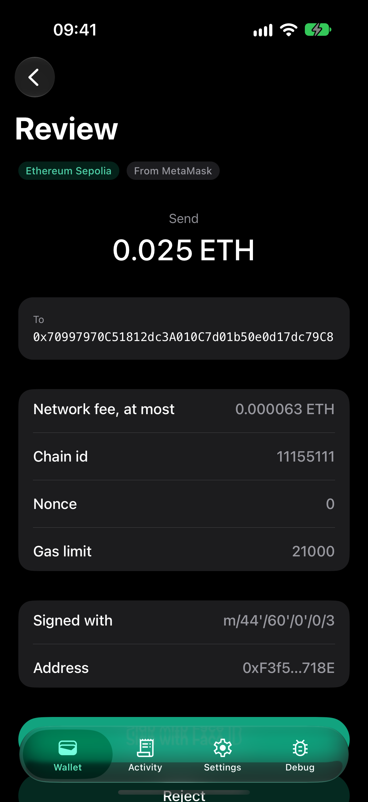
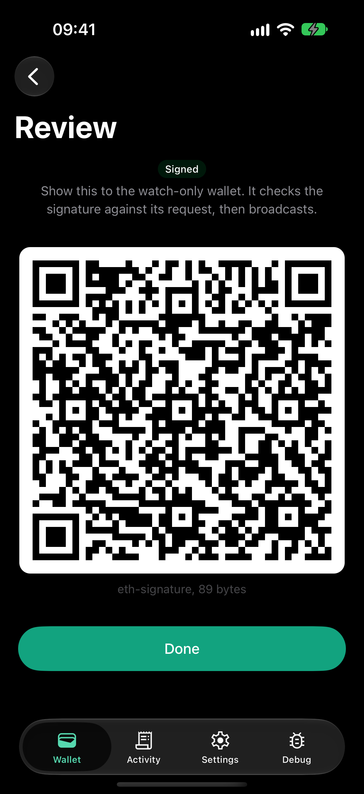

# nitro-crypto

[](https://www.npmjs.com/package/@hzblj/nitro-crypto)
[](./LICENSE)

Native cryptography for React Native and Expo: a Zig engine behind Nitro Modules hashes, signs and derives keys, and
holds every seed and private key in native memory. Chains are adapters, each its own package, on a typed registry:
Ethereum, Bitcoin and Solana here, any other chain whose primitives the engine has in a few dozen lines.

<p>
  
  
</p>

```sh
npx expo install @hzblj/nitro-crypto @hzblj/crypto-ethereum react-native-nitro-modules
```

```ts
import {ethereumAdapter} from '@hzblj/crypto-ethereum'
import {createCryptoEngine} from '@hzblj/nitro-crypto'

const crypto = createCryptoEngine({adapters: [ethereumAdapter()]})
const wallet = await crypto.createEphemeralWallet()
const account = await wallet.deriveAccount({chain: 'ethereum', index: 0})
const signature = await account.signMessage({message: 'Hello from Expo'})
```

**[Documentation](./packages/nitro-crypto/README.md)**: install, the API, supported algorithms, chains and platforms,
and what is not in this version.

### Air-gapped signing

A watch-only wallet and an offline signer (a hardware wallet, or a second phone that never goes online) exchange
requests and signatures as QR codes. [`@hzblj/crypto-airgap`](https://github.com/hzblj/crypto-airgap) is that protocol
(BC-UR v2, multipart fountain codes, typed and bounded decoding) without any UI, and a package per chain checks every
answer against its question through the adapters above:

```ts
import {createMultipartDecoder, createMultipartEncoder, createRequestId} from '@hzblj/crypto-airgap'
import {ethereumAirgap} from '@hzblj/crypto-airgap-ethereum'

const airgap = ethereumAirgap(crypto.chains.ethereum)
const request = {account, requestId: createRequestId(crypto.random), transaction}
const {sha256} = crypto.hash // the engine's: the protocol package has no hash of its own
const sender = createMultipartEncoder(airgap.encodeSignRequest(request), {sha256}) // the app shows sender.nextPart()

const receiver = createMultipartDecoder({allowedTypes: airgap.responseTypes, sha256}) // the app feeds it what it scans
const answer = airgap.decodeSignResponse(receiver.result(), {request}) // its signer recovered and checked
if (answer.kind === 'transaction') await rpc('eth_sendRawTransaction', [answer.transaction.serialized])
```

The example wallet as the offline signer: its account key for MetaMask, a request for another address of the account
as MetaMask sends one, and the signature.

<p>
  
  
  
</p>

## This repository

| Path | What lives there |
| --- | --- |
| `packages/nitro-crypto/` | `@hzblj/nitro-crypto`: the TypeScript facade and adapter registry, the Nitro specs and C++ bridge, the prebuilt engine |
| `packages/crypto-ethereum/`, `crypto-bitcoin/`, `crypto-solana/` | The chain adapters, each published on its own |
| `packages/zig-engine-crypto/` | The engine in Zig: its C ABI, tests, published vectors and benchmark (private; it ships inside `@hzblj/nitro-crypto`) |
| `apps/example/` | The example app: a testnet wallet (Sepolia, Bitcoin testnet4, Solana devnet) that sends and receives on the engine, signs offline over QR codes for a watch-only wallet, and a Debug tab with the self-test, accounts on four chains, signing, an air-gap loopback, primitives, benchmarks, security |
| `scripts/` | The engine's reproducible builds and their verification, the pack check, version sync |
| `docs/` | [Architecture](./docs/architecture.md), [adding an adapter](./docs/adding-an-adapter.md), [compatibility](./docs/compatibility.md) (air-gap interoperability included), [benchmarks](./docs/benchmarks.md), [decisions](./docs/adr) |

```sh
yarn                 # install
yarn engine          # build the engine for every platform this machine can (needs Zig 0.16.0)
yarn prebuild        # build the engine, then a clean `expo prebuild` of the example
yarn ios             # run the example on iOS (dev client); `yarn android` for Android
yarn test            # the Zig tests, vectors and C harness, and every TypeScript test on the engine as WebAssembly
yarn lint            # Biome and TypeScript
yarn engine:verify   # the prebuilt artifacts: digests, architectures, exported symbols
yarn pack:check      # pack every package as npm gets it and type-check a consumer
yarn changeset       # describe a change for the next release
```

## More libraries

The other libraries from the same author are at **[libraries.janblazej.dev](https://www.libraries.janblazej.dev)**.
